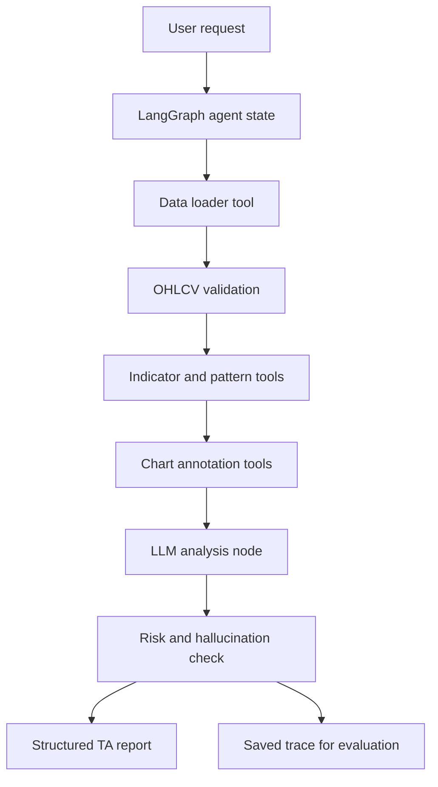

# Milburn

Goal: build an AI agent from scratch that can read OHLCV market data, run technical analysis actions on stock charts, and explain its reasoning through a locally hosted or self-hosted open-weight LLM.

This project is for learning agent architecture, tool wiring, model hosting, evaluation, and domain specialization. It is not intended to produce financial advice or an autonomous trading system.

## Current Framework Decision

Recommended primary framework: LangGraph.

Why:
- It exposes the agent loop clearly: state, nodes, edges, tool calls, retries, checkpoints, and finalization.
- It is industry-adopted, open source, and built for long-running stateful agents.
- It works with local or remote model servers through LangChain model integrations, including Ollama and OpenAI-compatible endpoints.
- It avoids hiding too much behind role-play abstractions, which makes it better for learning how agents actually work.

Secondary frameworks to keep in view:
- CrewAI: useful if the project later wants role-based teams such as analyst, risk reviewer, and chart narrator.
- Microsoft Agent Framework: strong enterprise-style framework and the successor path for AutoGen/Semantic Kernel.
- LlamaIndex: valuable later for storing and retrieving trading notes, chart-playbook examples, and post-analysis memory.
- Haystack: strong if the project evolves into pipeline-heavy market research and retrieval.

Avoid starting new work on classic AutoGen. Its own repository now points new projects toward Microsoft Agent Framework.

## Initial Architecture

The core design should keep deterministic analysis separate from LLM reasoning.

The LLM should decide which tools to call, combine results, ask for missing context, and explain conclusions. It should not calculate indicators by inventing values in text.



## Core Components

### 1. Agent Orchestrator

Use LangGraph to define the analysis flow:
- ingest request
- identify symbol, timeframe, date range, and requested analysis
- load OHLCV data
- validate data quality
- call TA tools
- generate chart annotations
- produce a structured report
- run a final consistency check

The graph should begin with a mostly deterministic workflow. Add more agent autonomy only after the tool outputs and evaluation harness are stable.

### 2. Data Layer

Phase 1 should use a free market-data API as the primary OHLCV source, not manually supplied CSV files.

Recommended Phase 1 source:
- Tiingo End-of-Day prices API for stock and ETF candles

Why Tiingo:
- official API with token authentication
- free tier is a better fit for repeated local development
- EOD prices provide raw and adjusted candle fields
- date-range requests and daily/weekly/monthly-style resampling map cleanly to Milburn's first chart-analysis workflows
- no real-time requirement for Phase 1, so daily historical candles are enough

Fallback and comparison sources:
- Yahoo Finance via `yfinance`: excellent quick-start source, broad coverage, no API key, but unofficial and personal/research-use only with no stable published rate limit.
- Twelve Data: official API, free Basic plan, 8 API credits/minute and 800/day, batch requests, stocks/forex/crypto coverage, useful as a second provider.
- Polygon/Massive: official API, high-quality US market data, free Basic plan with 5 API calls/minute and 2 years of historical data, but the free rate is low.
- MarketData.app: official API, free plan with 100 daily credits and 1 year of historical data, useful for limited comparison tests.
- CSV files: keep only for fixtures, regression tests, offline development, and reproducible eval cases.

Phase 1 should cache all pulled candle data locally so repeated agent runs do not burn Tiingo bandwidth and can be replayed exactly. Use Parquet for normalized candle payloads and DuckDB for cache indexes, LLM eval cache rows, eval metadata, scorer results, and trace indexes.

Phase 1 should not use MCP for market data. Instead, build provider classes behind a simple `CandleProvider` interface:
- `TiingoProvider` for primary API fetches
- `CacheProvider` for replay and quota control
- `CSVFixtureProvider` for tests and offline fixtures

This keeps the first implementation simple while preserving a clean future path: a later MCP server can wrap the same provider interface without rewriting the LangGraph TA agent.

Nice-to-have later enhancement:
- `IndexDataProvider` for direct index symbols such as S&P 500, Nasdaq Composite, Nasdaq-100, Dow Jones Industrial Average, Russell 2000, and VIX.
- This is out of scope for Phase 1. For now, use stock and ETF proxies available through Tiingo, such as `SPY`, `QQQ`, `DIA`, and `IWM`.

Validation checks:
- required columns
- sorted timestamps
- duplicate candles
- missing bars
- non-positive prices
- `high >= open/close/low`
- `low <= open/close/high`
- volume sanity checks

### 3. Technical Analysis Tool Layer

Start with deterministic Python functions:
- moving averages: SMA, EMA
- momentum: RSI, MACD
- volatility: ATR, Bollinger Bands
- volume: volume moving average, relative volume
- levels: swing highs/lows, support/resistance candidates
- trend: higher-high/higher-low and lower-high/lower-low detection
- candle patterns: engulfing, hammer, doji, inside bar

Potential libraries:
- `pandas`
- `numpy`
- `ta` or `pandas-ta`
- `scipy` for peak detection
- `mplfinance` or Plotly for chart rendering

Each tool should return structured JSON-like results, not prose.

### 4. LLM Layer

Local development:
- Ollama on the developer machine
- start with a model that supports tool calling reliably, such as Qwen, Llama, or another current tool-capable model available in Ollama

VPS/self-hosted path:
- vLLM on a GPU VPS
- expose an OpenAI-compatible API endpoint
- point the framework client at the VPS base URL

Design rule:
- the rest of the agent should not care whether the model is local Ollama or a remote vLLM server.
- use a small adapter/config layer with `provider`, `base_url`, `model`, `temperature`, and `timeout`.
- keep local model profiles in the project, preferably `src/milburn/llm/profiles.yaml`, so `milburn doctor --models` can display profile settings and local Ollama availability in one table.

### 5. Specialization Strategy

Specialization should happen in layers:

1. Tool design: precise deterministic TA tools with clear schemas.
2. Prompting: a chart-analysis system prompt that enforces evidence-based claims.
3. Repeat-run variance checks: run the same chart and prompt multiple times to measure stability.
4. Human feedback: rate and correct reports, especially unsupported or overconfident claims.
5. Few-shot examples: good reports over known chart setups.
6. Evaluation: compare outputs against expected tool use, report structure, and future chart behavior.
7. Memory/RAG: retrieve personal notes, trading rules, and prior chart reviews.
8. Fine-tuning: only after collecting enough high-quality examples.

Fine-tuning is not the first move. For this project, tool-use reliability and evaluation will teach more than immediately training a model.

The main recommendation is to judge the LLM on reasoning over evidence, not raw prediction or indicator math. A good report should say something like: "The 14-period RSI is 68.2, MACD histogram has declined for 4 candles, and price is 1.3% below a detected resistance zone. Momentum is still positive but weakening." A bad report says: "This stock looks ready to explode upward." The feedback loop should reward evidence-backed claims and penalize vague conviction.

Same-chart repeated runs should be part of the workflow. The project should save multiple runs for the same symbol, timeframe, date range, prompt, model, and config, then compare:
- tool calls
- indicator values cited
- support/resistance zones identified
- trend and momentum classifications
- unsupported claims
- confidence levels
- final report wording

Facts should remain stable because tools compute them deterministically. The narrative can vary slightly, but it should stay grounded in the same evidence.

## Proposed First Milestone

Build a CLI proof of concept:

```text
milburn analyze --csv data/spy_daily.csv --prompt "Analyze trend, RSI, MACD, and key support/resistance."
```

Expected output:
- parsed request
- data quality summary
- list of tools called
- structured indicator results
- generated chart image path
- final TA report with evidence references
- saved run trace

## Suggested Repository Structure

```text
milburn/
  README.md
  docs/
    framework-research.md
    data-source-research.md
    architecture.md
    eval-plan.md
  pyproject.toml
  src/
    milburn/
      __init__.py
      config.py
      graph.py
      llm/
        config.py
        profiles.yaml
        factory.py
      state.py
      cli.py
      data/
        loaders.py
        validators.py
      tools/
        indicators.py
        patterns.py
        levels.py
        charts.py
      prompts/
        system.md
      evals/
        cases.py
  data/
    samples/
  runs/
```

## Evaluation Plan

The project should measure more than whether the final answer sounds convincing.

Initial checks:
- Does the agent call the correct tools for the user request?
- Are indicator values calculated by tools, not invented by the LLM?
- Does the final report cite concrete data from tool outputs?
- Does the agent admit uncertainty when data is insufficient?
- Does it avoid financial advice language?
- Does the same input produce stable analysis at low temperature?
- Does a repeated run on the same chart preserve the same facts and broad insight?
- Do forward-looking technical scenarios become more or less useful when compared against later candles?

Example eval cases:
- uptrend with RSI overbought
- downtrend with bearish MACD cross
- sideways range with support/resistance
- missing volume column
- unsorted or malformed candles
- prompt asks for unsupported prediction

## Safety and Scope

The agent should:
- describe chart conditions
- summarize technical signals
- flag conflicting signals
- explain what additional data would help
- avoid direct buy/sell instructions
- avoid claims of guaranteed future price movement

The agent should not:
- place trades
- manage funds
- promise returns
- infer fundamentals unless explicitly given data
- use hidden or unverified data sources

## Next Build Steps

1. Scaffold the Python project with LangGraph, pandas, and a CLI.
2. Add a `CandleProvider` interface instead of using MCP for Phase 1 market data.
3. Add `TiingoProvider` for stock/ETF candle fetches.
4. Add `CacheProvider` with Parquet candle payloads plus a DuckDB cache/eval index.
5. Add `CSVFixtureProvider` as a fallback and test fixture path.
6. Add OHLCV validation.
7. Implement the first deterministic TA tools: SMA, EMA, RSI, MACD, ATR.
8. Add an Ollama-backed LLM adapter.
9. Build the first LangGraph flow around tool use and report generation.
10. Add sample data, cached API snapshots, and run traces.
11. Add eval cases before expanding the agent's autonomy.
12. Nice-to-have later: add an `IndexDataProvider` for true index symbols after the US stock/ETF workflow is stable.

## Advanced: Agent Harness Phase

This phase should begin only after the first TA agent is working end to end.

The first project goal is to build one specialized LangGraph agent:

```text
OHLCV data -> validation -> TA tools -> chart rendering -> evidence-backed insight report
```

The advanced goal is to extract the reusable operating environment around that agent. This is the "agent harness" layer.

An agent harness is not the same thing as the TA agent. The TA agent is one workflow. The harness is the runtime that can load workflows, manage tools, swap models, preserve context, save traces, enforce permissions, and run evaluations.

### Mental Model

```text
Model
  Qwen, Llama, Mistral, or another open-weight model

Model server
  Ollama locally or vLLM on a GPU VPS

Agent framework
  LangGraph

Domain agent
  Technical-analysis agent for OHLCV data and stock-chart insight

Agent harness
  Reusable runtime for tools, skills, context, sessions, traces, model configs, evals, and feedback

Application
  CLI, API, dashboard, notebook, or research workbench
```

LangGraph can live inside the harness as one execution engine. The harness is the broader shell that decides what agent or skill to run, what tools are available, what model provider to use, how to store run history, and how to replay or evaluate results.

### Why This Comes Later

Do not start by building a generic harness. The first TA agent will reveal what the harness actually needs.

Wait until the project has:
- a working CLI analysis flow
- deterministic OHLCV validation
- deterministic TA tools
- chart rendering
- local or self-hosted LLM calls
- structured reports
- saved traces
- basic eval cases
- human feedback records

At that point, repeated needs will become obvious: model switching, replay, tool registry, permission boundaries, skill loading, context management, and standardized run records.

### Transition Roadmap: Milburn to Harness

#### Phase 1: Complete the Specialized Milburn

Deliver:
- one LangGraph analysis workflow
- Tiingo-backed OHLCV input with local cache
- CSV/sample fixture fallback for tests
- deterministic indicators and chart tools
- local Ollama model adapter
- structured report schema
- saved run traces
- basic eval suite

Success means the agent can analyze the same chart repeatedly with stable facts and evidence-backed reports.

#### Phase 2: Extract a Runtime Boundary

Move from a direct CLI call:

```text
cli -> analyze_chart_graph(...)
```

To a runtime call:

```text
run_agent(agent_id, input, model_config, tools, memory, output_format)
```

This creates the first harness boundary. The CLI should no longer know the details of the LangGraph chart-analysis flow.

#### Phase 3: Create a Tool Registry

Replace direct imports with registered tools:

```text
tools/
  load_ohlcv
  validate_ohlcv
  calculate_rsi
  calculate_macd
  detect_levels
  render_chart
```

Each tool should declare:
- name
- description
- input schema
- output schema
- permissions
- deterministic or LLM-dependent
- safe for autonomous use or requires approval

#### Phase 4: Turn TA into a Skill Package

Package the first agent as a skill:

```text
skills/
  technical-analysis/
    skill.md
    graph.py
    tools.py
    prompts/
      system.md
      report.md
    schemas/
      report.schema.json
    evals/
      cases.yaml
```

The harness should be able to load this skill rather than hard-coding TA behavior.

#### Phase 5: Add Model Provider Management

Centralize model configuration:

```text
models:
  local-qwen:
    provider: ollama
    base_url: http://localhost:11434
    model: qwen-tool-model

  vps-llama:
    provider: openai_compatible
    base_url: https://your-vps.example.com/v1
    model: llama-tool-model
```

The harness should support switching models without changing the TA graph.

#### Phase 6: Add Session, Trace, and Replay

The harness should preserve:
- prompt
- model config
- tool calls
- tool outputs
- generated chart paths
- final report
- human feedback
- future outcome scores

Add replay modes:
- rerun same chart and prompt with same model
- rerun same chart and prompt with a different model
- rerun same chart with changed prompts
- compare outputs across runs

#### Phase 7: Add Evaluation and Feedback Commands

The harness should expose commands like:

```text
ai-agent run technical-analysis --csv data/spy.csv --prompt "Analyze momentum"
ai-agent replay runs/20260607-001
ai-agent eval technical-analysis --suite basic-ta
ai-agent compare --suite AAPL-2024H1 --runs 10
ai-agent feedback runs/20260607-001 --label "too confident"
```

This turns the project from one agent into a measurable agent development environment.

#### Phase 8: Support Multiple Domain Agents

Only after TA works as a skill, add more skills:
- market-news summarizer
- earnings-call note retriever
- backtest explainer
- portfolio risk explainer
- strategy journal reviewer

This is when the harness becomes broadly useful.

### Harness Features to Consider

Advanced harness features:
- tool registry
- model registry
- skill registry
- prompt template registry
- context loading rules
- session tree or run history
- trace storage
- replay engine
- eval runner
- feedback store
- permission policy
- approval gates for risky tools
- local/VPS model routing
- CLI, JSON, RPC, or SDK modes

The local inspiration from projects like Pi is not that this project should become a coding agent. It is that a small harness can provide reusable primitives: tools, context, model providers, skills, traces, and extensions. For this project, those primitives should be shaped around market-analysis workflows instead of file editing and shell automation.
